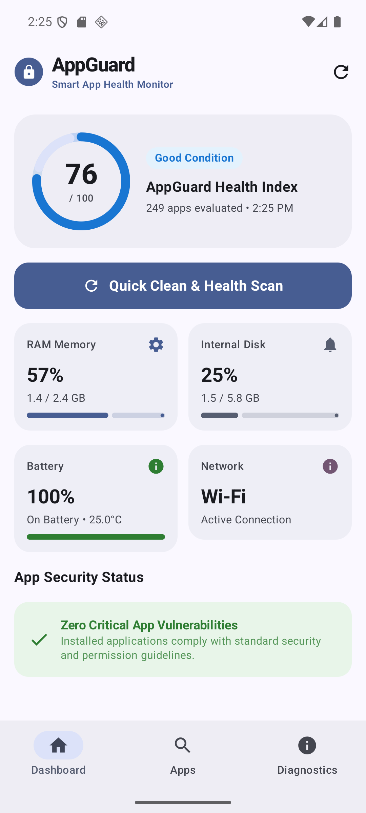

# The-Outliers
Daemon Hour hackathon project - team The-Outliers


# AppGuard 🛡️
**Smart Android App Health Monitor**

> Developed by team **The-Outliers** for the Daemon Hour Hackathon.

<p align="center">
  
</p>

---

## 🚀 Overview

**AppGuard** is an intelligent Android application designed to monitor device app health in real-time. It empowers users to track background resource consumption, detect anomalous behavior, optimize battery and memory usage, and maintain overall device security and performance.

---

## ✨ Key Features

- **Real-Time Health Dashboard:** Instant overview of system performance, active apps, and health scores.
- **Resource Usage Tracking:** Monitor CPU, RAM, and battery drain per application.
- **Anomaly & Threat Detection:** Alerts users regarding suspicious background activities or unauthorized permissions.
- **Smart Optimizations:** One-tap recommendations to clean up RAM, close resource-heavy background processes, and extend battery life.
- **Individual AI App Insights (Google Gemini & Firebase AI Logic):** On-demand, non-destructive AI lifecycle analysis for every installed application, evaluating update recency, platform compatibility, and maintenance state.
- **Sleek, Modern UI:** Built natively for Android following modern Material Design principles.

---

## 🛠️ Tech Stack & Architecture

- **Language:** Kotlin / Java
- **UI Framework:** Jetpack Compose / XML Layouts (Material Design)
- **Architecture:** MVVM (Model-View-ViewModel)
- **Android SDK APIs:** UsageStatsManager, ActivityManager, BatteryManager, PackageManager

---

## 📂 Project Structure

```tree
The-Outliers/
├── app/                  # Main Android application module
├── gradle/               # Gradle wrapper and configuration files
├── build.gradle.kts      # Project-level Gradle build script
├── settings.gradle.kts   # Gradle settings and module inclusions
└── appguard_screen.png   # App UI preview asset
